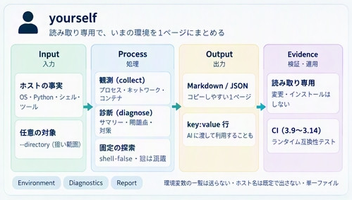
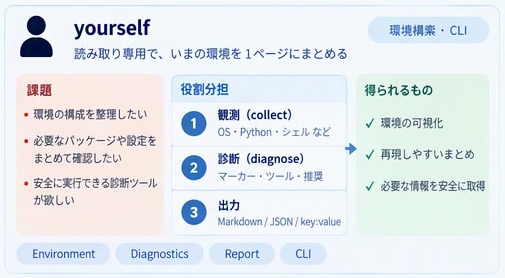

# yourself

Single-file, standard-library Python tool for read-only inspection of host, OS, and runtime facts. Produces concise, copyable environment reports for troubleshooting and AI context.

## Concept overview



Read-only host and runtime observations are formatted as text, Markdown, or JSON for troubleshooting and assistant context. Optional observation scopes and fixed probes are described below.

The panel’s hostname-default note applies to `collect()`. The no-argument CLI includes hostname and network facts; `--no-network` omits that block, while `--minimal` keeps only OS/Python observations.

### Challenges, roles, and outcomes



Complementary view of observation, diagnosis, and report output. The panel’s “recommendations” wording is conceptual: `diagnose()` reports facts, not recommendations or a complete dependency/configuration inventory. The hostname/network disclosure notes above still apply.

## Design

The canonical artifact is `yourself.py`: copy it to `vendor/yourself.py` without pip or supporting modules. Like `markdown` and `ascii_artist`, it provides functions, `__all__`, and `__version__`; import is inert. A thin guarded main delegates to existing APIs. The advanced CLI remains in `scripts/yourself_cli.py`.

Python target: 3.9–3.14 for the stdlib runtime; contributor tests use Python 3.11+ via uv (see [Runtime and development Python policy](#runtime-and-development-python-policy)). Runtime is standard-library only.

## Public API

| Function | Contract |
| --- | --- |
| `collect(...)` | OS and Python runtime observations; optional host name and immediate directory summary. |
| `directory_summary(path, sample_size=10)` | Immediate file/directory/symlink/other counts, sorted bounded name sample and entry errors. |
| `to_json(facts)` | Sorted Unicode JSON, rejecting non-finite numbers. |
| `to_markdown(facts)` | Concise report with control characters and table/HTML delimiters escaped. |

```python
import yourself

facts = yourself.collect()
print(yourself.to_markdown(facts))
print(yourself.to_json(yourself.collect(directory=".", sample_size=5)))
# Include the hostname only when needed:
print(yourself.to_json(yourself.collect(include_host=True)))
```

## Supported / unsupported

- Read-only OS/runtime facts using stdlib APIs; no shell, network requests (except the opt-in `--reach` handshake below), package installation, service start/stop or build execution. Fixed version-only subprocesses require `versions=True` / `--versions`.
- Directory observation is opt-in, shallow, includes hidden names, never reads file contents and counts symlinks without following them. Symlink roots are rejected. Individual entry errors are reported; invalid/unreadable roots raise.
- A sorted sample is deterministic for the same directory snapshot. Environment values can change. Filesystem races are not isolated.
- Default output omits host name and directory. Opt-in names/paths can identify a machine or project; choose what to include before sharing.
- The no-argument CLI also reports host name, local IPv4/IPv6 addresses, interfaces, the default gateway, DNS servers, container/VM hints (Docker, Podman, Kubernetes, containerd, LXC, hypervisor flag) and whether proxy variables are set. All of it comes from local files (`/proc`, `/sys`, `/etc/resolv.conf`, marker files); no packets, DNS lookups or commands. Proxy values are never printed because they can carry credentials. `--no-network` omits this block.
- No environment-variable dump, username collection, recursive inventory, project inference, dependency inspection or Git identity. Repository position (repository, SHA, branch, changes) is reported by `python gh_identity.py local-position` in the [gh_identity](https://github.com/myon-bioinformatics/gh_identity) repository, not by this file, which stays dependency-free.

## One command (`python yourself.py`)

With no options, `yourself.py` prints one `key: value` line per fact, ready to paste:

```text
cwd: /work/app
user: app (uid 1000, root=false)
writable_cwd: true
shell: bash
lang: C.UTF-8
timezone: Asia/Tokyo
local_time: 2026-10-11T22:45:57+09:00
display: false (headless)
python_executable: /usr/local/bin/python3
virtualenv: false
ca_env.SSL_CERT_FILE: false
ci: CI=false GITHUB_ACTIONS=false
os: Linux 6.8.0 x86_64
os_release: ubuntu 24.04
python: CPython 3.12.3 64bit
in_container: true
container_kinds: docker
virtualized: false
hostname: 3f2a9c1d
ipv4: 172.17.0.5, 127.0.0.1
interfaces: eth0(up), lo(unknown)
default_gateway: 172.17.0.1 via eth0
dns: 127.0.0.11
proxy.HTTPS_PROXY: true
proxy.no_proxy_covers.localhost: false
cpus: 8 (usable 8, cgroup limit 2.0)
memory: 3.1 GiB available of 15.5 GiB (cgroup limit 4.0 GiB, swap 0.0 GiB)
load: 0.42 0.30 0.21
uptime: 3d 4h12m
open_files_limit: 1048576
disk_free: 41.2 GiB of 100.0 GiB
markers: pyproject.toml, Dockerfile
listening: 0.0.0.0:8080, 127.0.0.1:5432, [::1]:3000
tool.docker: true
tool.nvidia-smi: false
...
```

Tools are `true` / `false` presence (versions only with `--versions`). Each key
appears once.

It also **runs** a few fixed probes and reports each as `true …` or
`false (reason)`; a failure is a result (the daemon may be down, the tool may be
missing), never an error of the report:

```text
hosts.localhost: 127.0.0.1, ::1
localhost.ipv6_loopback: true
localhost.resolves_to: true ::1             localhost
docker.context: true default
docker.server: true 27.3.1
docker.networks: true bridge bridge local; host host local; none null local
docker.bridge: true 172.17.0.0/16 gw=172.17.0.1
docker.containers: true web nginx:1.27 running 0.0.0.0:8080->80/tcp
docker.images: true nginx:1.27 192MB; python:3.12-slim 124MB
gpu: false (not_installed)
```

`hosts.localhost` lists every `/etc/hosts` mapping: when it shows both
`127.0.0.1` and `::1`, a server bound only to `127.0.0.1` may not answer on
`localhost`; `listening` shows the bind address of every local TCP listener
for the same reason (`127.0.0.1:5432` is not reachable from another container,
`0.0.0.0:8080` is). `localhost.resolves_to` is the address the system resolver
gives first (`getent hosts localhost`), and `localhost.ipv6_loopback: false`
means `::1` cannot answer at all. Proxy and CA bundle variables are reported as
set/unset only; `proxy.no_proxy_covers.*` says whether `NO_PROXY` exempts
`localhost`, `127.0.0.1` and `::1` (`*`, `.localhost` and CIDR such as
`127.0.0.0/8` count) without printing its value — with a proxy set and
`false` here, requests to a local server go through the proxy.
Probes use `docker … --format '{{…}}'`, `getent hosts localhost` and `nvidia-smi --query-gpu`
with `shell=False`, 3 s each, at most 20 lines. `--no-probes` skips them. `--format json|markdown` gives the same facts in other shapes;
`--no-network` drops the network/container block; `--minimal` keeps OS/Python only.

### CI runner fingerprint (opt-in)

When a job misbehaves because of the **hosted image** (for example GitHub-hosted Ubuntu on Azure), the default report does not say which image or package set ran. `--runner-env` collects an offline `runner-fingerprint/1` snapshot for CI forensics:

```sh
python yourself.py --runner-env
python yourself.py --runner-env --runner-env-json
python yourself.py --runner-env --runner-env-dpkg-list /tmp/dpkg.txt   # Linux only
python yourself.py --runner-env --runner-env-imds                     # explicit metadata HTTP
python yourself.py --runner-env --runner-env-github-summary           # append to GITHUB_STEP_SUMMARY
```

It records GitHub Actions env vars (`RUNNER_OS`, `ImageOS`, `ImageVersion`, tool-cache paths), optional `imagedata.json` (object or GitHub’s array form), OS identity (`/etc/os-release` or platform-specific), kernel/Python, a cloud guess from DMI + `/var/lib/waagent`, a `dpkg-query` package count and SHA-256 (full list only when `--runner-env-dpkg-list` is set), and tool-cache directory versions. DMI values are used only internally; output contains fixed provider labels, never raw identifiers. Object-form imagedata exposes only string-valued image, ImageOS, and ImageVersion fields. Reads stop at 2 MiB plus one overflow byte. Every probe fails soft; missing data is recorded with a reason. Instance metadata is **not** fetched unless `--runner-env-imds` is set; then `urllib.request` is used with an empty proxy map, ~1 s timeout, and only allowlisted compute fields (`osType`, `location`, `vmSize`, `sku`, `offer`, `version`)—never subscription, resource group, VM id, name, or tags. Default `python yourself.py` output is unchanged without `--runner-env`. CI on `ubuntu-latest` / Python 3.12 uploads `runner-fingerprint.json` as an artifact.

```sh
python scripts/runner_fingerprint_mutations.py
```

## Can this session reach a host? (`--reach`)

```sh
python yourself.py --reach pypi.org registry.npmjs.org cdn.jsdelivr.net github.com
# reach.pypi.org: ok (TLSv1.3) via direct 73ms
# reach.cdn.jsdelivr.net: proxy_denied (403 request blocked: no rule or allowlist entry allows host "cdn.jsdelivr.net") via proxy 289ms
```

Opt-in and the only network use in this module: for each `HOST[:PORT]` (default 443)
it opens TCP (through `HTTPS_PROXY` with `CONNECT`, unless `NO_PROXY` covers the host)
and completes a TLS handshake, then closes. No HTTP request is sent to the site and
nothing is read from it; the proxy URL and credentials are never printed. Statuses:
`ok`, `proxy_denied` (with the CONNECT status and the proxy's short reason), `dns`,
`refused`, `timeout`, `tls_error` (often a proxy CA missing from the trust store;
`SSL_CERT_FILE` is used when set), `unreachable`, `invalid_host`. Exit 0 when all are
`ok`, else 1; `--format json` gives the rows; `--reach-timeout` (default 5 s).

The default report also lists installed runtimes from directory names only: Playwright
browser builds with revisions (`playwright_chromium: full+shell`, `shell only
(--only-shell)` or `full only (--no-shell)`), uv-managed interpreters, `python3.X` on
PATH and, with `--versions`, whether git has `merge-tree --write-tree` (2.38+).

## CLI

```sh
python scripts/yourself_cli.py
python scripts/yourself_cli.py --format json --directory . --sample-size 5
python scripts/yourself_cli.py --include-host
```

Outputs only to stdout; error diagnostics go to stderr. Exit code 0 = successful observations, 2 = invalid input or directory errors. No report file is written automatically.

## Tests

```sh
python -m pip install -r tests/requirements.txt
python -m pytest --cov=yourself --cov-branch --cov-report=term-missing --cov-fail-under=90
```

Tests cover host opt-in, no content reads, shallow counts/sorted sample bounds, symlinks, entry/root errors, Unicode/control-safe reports, JSON round-trip, CLI execution from another directory and independent vendoring. CI runs the stdlib runtime lane on Python 3.9–3.14 (Linux) and 3.9 (Windows/macOS); pytest with coverage runs on Python 3.11–3.14 (Linux) and 3.12 (Windows/macOS).

## Compact environment diagnosis (0.2)

The original purpose is to give Copilot/other assistants a short environment introduction, so they do not repeatedly explore the same host. `collect()` stays minimal; `diagnose()` adds measured context with explicit scope.

| API | Observation |
| --- | --- |
| `command_inventory(names=None, versions=False)` | Presence of fixed Python/Git/Docker/Node/compiler/build/search tools, including goma/gomacc. |
| `workspace_facts(path)` | Immediate project-marker presence (Python/Node/Flutter/Docker/CMake/GN/goma), plus disk byte counts; no file-content reads. |
| `listener_ports()` | Linux proc TCP LISTEN ports only; no address/PID output or network connections. Other platforms explicitly report unsupported. |
| `diagnose(...)` | OS/runtime, selected distro ID/version, tools and optional workspace/listener facts. |

```python
import yourself

print(yourself.to_markdown(yourself.diagnose()))
# Caller explicitly authorizes fixed version observations and workspace scope:
print(yourself.to_json(yourself.diagnose(directory=".", versions=True)))
```

```sh
python scripts/yourself_cli.py --diagnose
python scripts/yourself_cli.py --diagnose --directory . --versions --command python --command docker
python scripts/yourself_cli.py --diagnose --ports --format json
```

Default diagnosis discovers tool presence without executing tools. `--versions` permits only the built-in fixed version argv, with `shell=False`, stdin disabled and timeout; numeric versions alone are reported. Missing tools, timeout, nonzero exit, execution error and unrecognized versions stay distinct. Command paths, environment values and raw stdout/stderr are omitted. CLI returns 2 for partial observation errors, while missing tools and intentional presence-only observations are ordinary facts.

Flutter/Dart/npm/pytest/goma/gomacc are **presence-only**, even with `--versions`, because their entry points can bootstrap or initialize state. Docker uses `docker --version` only; no daemon query or container execution. Version commands require trusted PATH binaries; a substituted executable can have arbitrary behavior. A probe captures subprocess output in memory before considering at most its first 8192 bytes for numeric version extraction; this is not an isolated runner or a hostile-output memory limit.

Workspace marker presence does not prove buildability or installed dependencies. Symlink markers are ignored. Listener observation reads Linux proc locally; Windows/macOS return `measured=false` with `unsupported_platform`, and proc permissions/partial reads remain errors. There is no port scan, remote request, package enumeration, configuration dump, service repair, Redis/Celery integration or Git-identity collection.

CI preserves job-specific JUnit artifacts even on test failure, for aggregation
by the shared xprobe importer. This module does not duplicate JUnit parsing.

## Native pytest evidence

CI also preserves native pytest JSONL for outcome exploration, including xfail
and phase errors. See [usage and provenance](docs/pytest-observations.md).

## Direct standalone use (0.3)

```sh
python yourself.py
python yourself.py --format json
python yourself.py --minimal
```

Python alone is sufficient, including `python -S /path/to/yourself.py`.
No pip, virtual environment, pytest or JUnit setup is required.

The main is only an entry/formatting layer: default calls existing
`diagnose(directory=".")` and `to_markdown`; --format json uses `to_json`;
--minimal calls `collect()`. No new main-specific diagnostic engine or
project recommendation function is introduced.

The fixed inventory combines presence-only tools for package managers, shells,
search/archive tools, languages, build tools and services (including poetry,
pdm, pixi, rye, swift, meson, winget, brew, grep, zstd and git-lfs).
Presence-only entries never execute, even with `--versions`; presence does not
prove authentication, build or service readiness. `ruff` supports the fixed,
explicit opt-in `--version` probe alongside the existing version allowlist.
Workspace detection uses one marker registry across the Python APIs and CLI.
It lists only the root's entry names and lstat-checks recognized entries, without
reading contents or following symlinks. `justfile` and `Justfile` are explicit
aliases reported once as `justfile`, even when both exist on Linux. `pixi.toml`
uses its exact official spelling; `Pixi.toml` is ignored on every OS. Other
markers also use exact registered spellings, independently of filesystem casing.
Distinct marker names remain distinct even if hardlinked. `.goma` and `.venv`
may be directories; other markers must be regular files. Listing/stat failures
are reported as errors. Session facts include the virtualenv basename, and
PATH Python discovery covers `python3.8` through `python3.15` without execution.
No test/build/browser execution, installs, repairs, environment dump or
project-content reading. Workspace markers and disk facts use existing APIs.
Import stays inert, APIs remain reusable, and existing scope/caveats apply.
Exit 2 marks invalid/partial observations; output goes to stdout only.

## Runtime and development Python policy

The standard-library runtime (`yourself.py`, vendored copies) supports Python
**3.9+**. `pyproject.toml` declares `requires-python = ">=3.9"` with
`dependencies = []` so metadata matches the stdlib-only artifact. Contributor
tooling is separate: `[tool.uv]` sets `environments = ["python_version >= '3.11'"]`
and the `dev` dependency group requires Python 3.11+, so `uv sync` never targets
3.9–3.10 even though the runtime does.

The `runtime-compatibility` CI workflow exercises behavior with `python -S` and
no site-packages (no pytest install). The main `CI` workflow runs locked
`uv sync` and full pytest on 3.11+ only.

```sh
# Stdlib runtime floor (matches CI runtime-compatibility lane)
uv python install 3.9
uv run --python 3.9 --no-sync python -S -m unittest discover -s tests -p test_yourself.py -v

# Locked contributor tests (Python 3.11+)
uv sync --locked --python 3.11
uv run --locked python -m pytest
```

`pyproject.toml` is the canonical development dependency definition; legacy
`tests/requirements.txt` remains for downstream callers that still use pip.
Runtime `requires-python` does not raise the vendoring floor to the development
floor. CI pins `actions/setup-python` v7.0.0 and `astral-sh/setup-uv` v10.3.0
by full commit SHA and installs uv 0.13.3. Setup actions using Node 24 require
runner 2.327.1 or newer (GitHub-hosted runners satisfy this).
